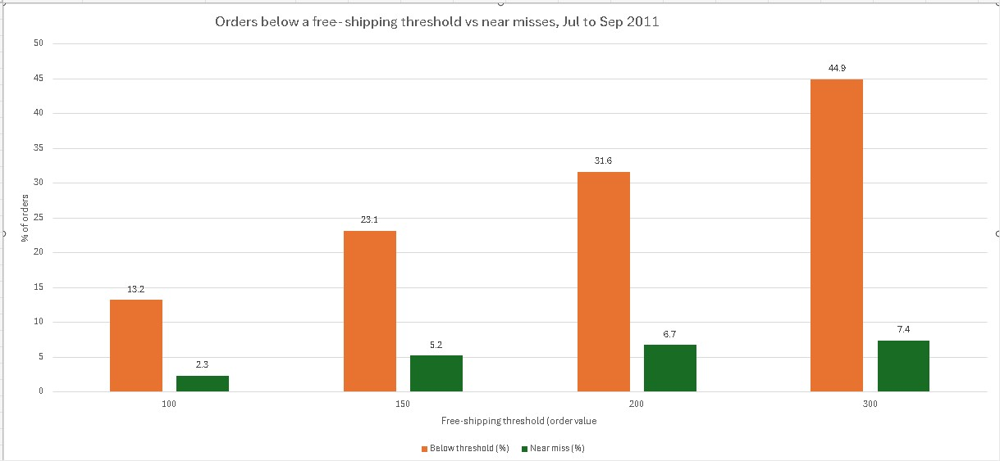

# SQL Retail Business Analysis

**Read the full write-up:** [Case study (PDF)](case-study.pdf)

Three business questions about an online retail store, answered with SQL. I used SQLite for the analysis, Excel for the chart, and generative AI (Claude) as a tutor, and I verified every result.

## Business questions

| # | Stakeholder | Question |
|---|---|---|
| 1 | Growth Marketing Manager | Among first-time customers who had not reordered by day 14, what share reordered between day 15 and day 60? This is the baseline a day-14 email test has to beat. |
| 2 | Head of Merchandising | Which products have the highest cancellation rate (cancelled lines ÷ sold lines), so they can be reviewed for quality or listing problems? |
| 3 | E-Commerce Director | How are order values spread, and how many orders sit just below each candidate free-shipping threshold? |

## Data

- **Source:** [Online Retail Dataset on Kaggle](https://www.kaggle.com/datasets/divanshu22/online-retail-dataset)
- **Size:** 541,909 rows, 8 columns (`InvoiceNo`, `StockCode`, `Description`, `Quantity`, `InvoiceDate`, `UnitPrice`, `CustomerID`, `Country`)
- **Period:** 1 December 2010 to 9 December 2011
- **Currency:** not stated in the file
- The raw data is not stored in this repository (file size and the publisher's rights). Download it from Kaggle to reproduce the analysis.

## Tools

SQLite (through DB Browser for SQLite), Excel, Claude (AI tutor)

## Process

I followed the Ask, Prepare, Process, Analyze, Share, Act framework.

**Prepare.** I imported the CSV into a table called `online_retail` and profiled it before analysing anything:

| Check | Result |
|---|---|
| Rows | 541,909 |
| Rows with no `CustomerID` | 135,080 (about 25%) |
| Cancellation lines (`InvoiceNo` starts with `C`) | 9,288 |
| Rows with quantity or price of 0 or less | 11,805 |

**Process.** I never edited the raw table. I built a view, `sales_clean`, that removes cancellations and rows with non-positive quantity or price (530,104 rows remain) and adds `line_total`. A second view, `order_totals`, gives one row per invoice with its total value.

**Definitions that change the answers:**
- *First order* = the customer's earliest `InvoiceDate` in this data. It may not be their first ever purchase.
- *Repeat* = an order on a later date within the window. Several invoices on the first day count as one first purchase.
- *Eligible customers* = known `CustomerID`, and a first order at least 60 days before the end of the data, so everyone had time to repeat.
- *Product* = a `StockCode` that starts with five digits, which excludes codes such as `M` (Manual).
- *Cancellation rate* is measured in lines, not units, because a few huge single-line reversals (for example 80,995 units on one line) would swamp a units-based rate.

## Findings

### Q1: Repeat purchases
- 3,741 customers were eligible. 382 (10.2%) reordered within 14 days.
- Of the 3,359 who had not reordered by day 14, **932 (27.7%) reordered on days 15 to 60.**
- Any repeat within 60 days: 1,314 of 3,741 (35.1%).

### Q2: Cancellations
Among products with at least 50 sold lines, the highest cancellation rates were:

| Product | Cancellation rate |
|---|---|
| Savoy Art Deco Clock | 24.5% |
| White Tea, Coffee, Sugar Jars | 22.0% |
| Retro Plastic Elephant Tray | 20.0% |

Across the store, cancellation lines are roughly 2% of sales lines.

### Q3: Free-shipping thresholds (Jul to Sep 2011, 4,673 orders)

| Threshold | Orders below it | Near misses (within 20% below) |
|---|---|---|
| 100 | 13.2% | 2.3% |
| 150 | 23.1% | 5.2% |
| 200 | 31.6% | 6.7% |
| 300 | 44.9% | 7.4% |

## Recommendations

1. **Q1:** Test a day-14 email with a random no-email control group instead of rolling it out to everyone. Compare against the 27.7% baseline and track the discount cost. Only a few hundred eligible customers arrive each month, so plan the sample size first.
2. **Q2:** Review the three highest-cancellation products first, ask customer service for the cancellation reasons, and start recording a reason code on every cancellation.
3. **Q3:** A threshold change alone will nudge only a small group (2% to 7% of orders). Gather shipping-cost data, model profit at thresholds of 150 and 200, and test one threshold on a share of customers before changing it.

## Limitations

- The data has no shipping costs, product costs, cancellation reasons, or website behaviour. The analysis describes what happened. It does not show what caused it, and it cannot show profit.
- About 25% of rows have no `CustomerID`, so Q1 excludes them.
- "First-time" means first order in this data.
- The "within 20% below" window in Q3 is my own choice.
- A cancellation line does not say which original sale it reverses.

## How I used generative AI, and how I verified it

Claude acted as my project tutor. It supplied the analysis queries and explained concepts. I ran every query myself in a real database and checked the results independently.

| Step | AI contribution | How I verified |
|---|---|---|
| Business questions | Drafted example questions | I checked each metric against the available columns, dropped metrics that needed cost or website data, and rewrote the questions |
| Data load | Import steps | Row count matched the 541,909 rows in the spreadsheet |
| Cleaning | `sales_clean` view | 530,104 rows = 541,909 minus the 11,805 rows with non-positive quantity or price |
| Q1 | Repeat-purchase queries | Hand check on customer 17850; total of 3,741 matched between two queries; 3,359 = 3,741 − 382; 382 + 1,166 − 234 = 1,314 matched the first result |
| Q3 | Order-value and threshold queries | Band counts added up to 4,673, the same as a separate `COUNT(DISTINCT InvoiceNo)`; the 100 and 200 thresholds matched figures calculated from the bands |
| Q2 | Cancellation queries | Cancellation count (9,288) matched across two queries; for product 22461, hand-run counts (53 sold lines, 13 cancel lines) matched the output; I recalculated six rates by hand |

Two mistakes caught along the way: an example threshold of 50 turned out to be unsuitable (only 7.7% of orders fall below it), and a first verification query used a placeholder product code that returned 0, so I reran it with a real code.

## Repository contents

- `README.md`: this file
- `queries.sql`: every query used, in order
- `q3_threshold_chart.png`: the Q3 chart

## How to reproduce

1. Download the CSV from the Kaggle link above.
2. In DB Browser for SQLite, create a database and import the CSV as a table named `online_retail` (tick "Column names in first line").
3. Run `queries.sql` section by section and compare each result with the expected values noted in the comments.
